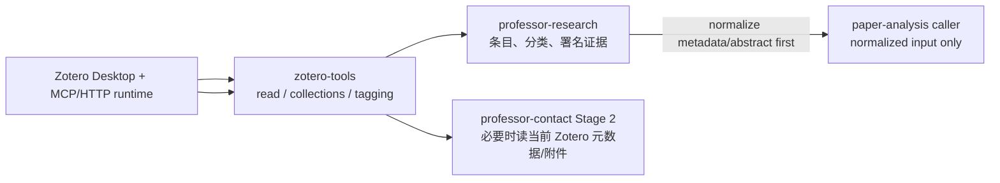

# zotero-tools

`zotero-tools` 提供 ScholarWorkflow 的 Zotero 读取、分类与论文标签工作流。它封装项目级 caller/agent 约定，但**不会把 Zotero Desktop、MCP 插件或本地 HTTP 服务本身打包进仓库**。

当前 APM target 为 `opencode` 与 `codex`。

## Nix 包

当前 Nix flake 只发布经过验证的 `aarch64-darwin` 包。两个包可分别构建或安装到用户 profile：

```sh
nix build .#zotero-tools
nix build .#zotero-collection-cleaner
nix profile install .#zotero-tools
zotero-paper-tagger --help
zotero-item-export --help
```

`zotero-tools` 包含 `zotero-read`、`zotero-collections`、`zotero-paper-tagger` 和三个命令行入口；`zotero-collection-cleaner` 是单独选择的技能与 Codex 角色。安装到 profile 提供命令和固定资源，但不会把技能复制进某个项目。项目需要通过固定版本的 [agent-env-nix](https://github.com/RekiDunois/agent-env-nix/tree/ba2d0fe4ef4d1dc1d80ec628c3ecc6607829a76e) 组合所需包，再显式运行 `agent-env apply --project /项目绝对路径`。消费者 flake 可按下面的方式生成部署命令：

```nix
{
  inputs = {
    nixpkgs.url = "github:NixOS/nixpkgs/55bfb4d7437bd4e09ab7cba58a43bd68eb310044";
    producer.url = "github:ScholarWorkflow/zotero-tools/<producer-sha>";
    producer.inputs.nixpkgs.follows = "nixpkgs";
    shared.url = "github:RekiDunois/agent-env-nix/ba2d0fe4ef4d1dc1d80ec628c3ecc6607829a76e";
    shared.inputs.nixpkgs.follows = "nixpkgs";
  };

  outputs = { nixpkgs, producer, shared, ... }:
    let
      system = "aarch64-darwin";
      pkgs = nixpkgs.legacyPackages.${system};
    in {
      packages.${system}.default = shared.lib.mkProject {
        inherit pkgs;
        roots = [ producer.packages.${system}.zotero-tools ];
      };
    };
}
```

将 `<producer-sha>` 换成固定的 40 位提交号后，在消费者目录运行 `nix build .#default`，再运行 `./result/bin/agent-env apply --project /项目绝对路径`。要单独部署 cleaner，只需把根包改为 `producer.packages.${system}.zotero-collection-cleaner`；profile 安装和项目部署是两个分开的入口。共享仓库是私有仓库时，Nix 需通过现有 GitHub/Nix 认证读取；不要将访问令牌写进 flake。

`agent-env apply` 会整体替换所选技能目录和角色文件，包括已有同名内容及用户直接编辑；未选中的资源和相邻文件不受影响。配置保护只针对所选的 `mcp_servers` 项：等价的既有定义会复用，用户改过的生成值会保留并报告冲突，其他配置字段不改。应用失败可能留下部分更新；排除故障后，从项目目录重新运行 `./result/bin/agent-env apply --project /项目绝对路径`。

两包默认只导出 Codex 资源，可在 Nix 表达式中对单个包设置 `enableHarnesses = []`。APM 的 Codex/OpenCode 路径与原有 `uv` 工作流继续使用源目录，不受 Nix 副本调整影响。运行时仍需 Zotero Desktop 和相应本地 MCP/HTTP 服务；`ZOTERO_HTTP_URL`、`ZOTERO_MCP_URL` 与 `ZOTERO_STORAGE_ROOT` 可在调用时覆盖。程序不把输出写进 Nix store；使用者应把导出、缓存和日志目录指向可写位置。

## 在教授/套磁工作流中的位置



`paper-analysis` 本身不拥有 Zotero integration；Zotero-aware caller 应先在上游把需要的 metadata/abstract 规范化，再传给单篇分析。

## Package 与宿主环境要分开

APM 安装能保证本仓 skills/agents 随依赖闭包进入 consumer，但真实运行仍需要相应宿主条件，例如：

- Zotero Desktop 正在运行；
- 需要的 Zotero MCP 插件/本地服务已启用；
- runtime 使用的 endpoint 与当前隔离 fixture/用户实例一致；
- 写入类操作有明确 owner 与范围，不能因为 MCP 可达就跨 Stage 改写状态。

这些条件属于 runtime prerequisite；不能用“仓库已安装”推导“Zotero 一定在线”，也不能把生产 Zotero 库当自动化测试 fixture。

## 与 professor-contact 的边界

Zotero 是论文/元数据/附件存储与辅助组织层，不是套磁 target state：

- Stage 0 的机器目标来自 normalized `方向预筛.json` → `套磁目标.json`，不是 Zotero 固定标题 note；
- formal direction collection key 不是 canonical contact direction identity；
- Stage 3/5 不回读 Zotero 重建自己的唯一事实源；
- Stage 5 不需要 Zotero。

套磁状态机以 `ScholarWorkflow/professor-contact` 当前 workflow reference 为准。
